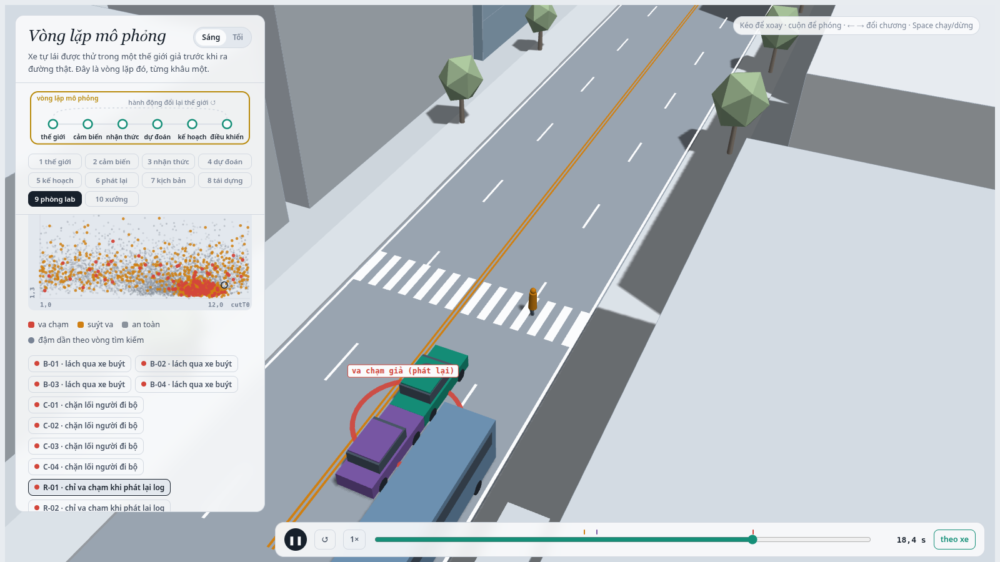
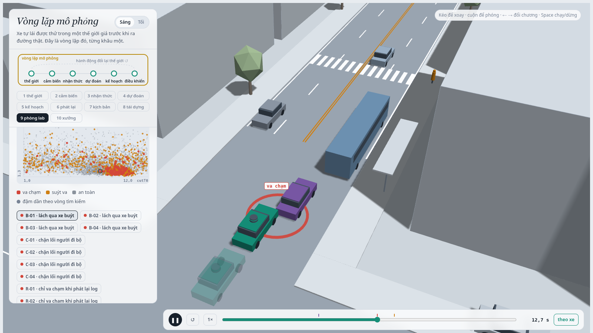
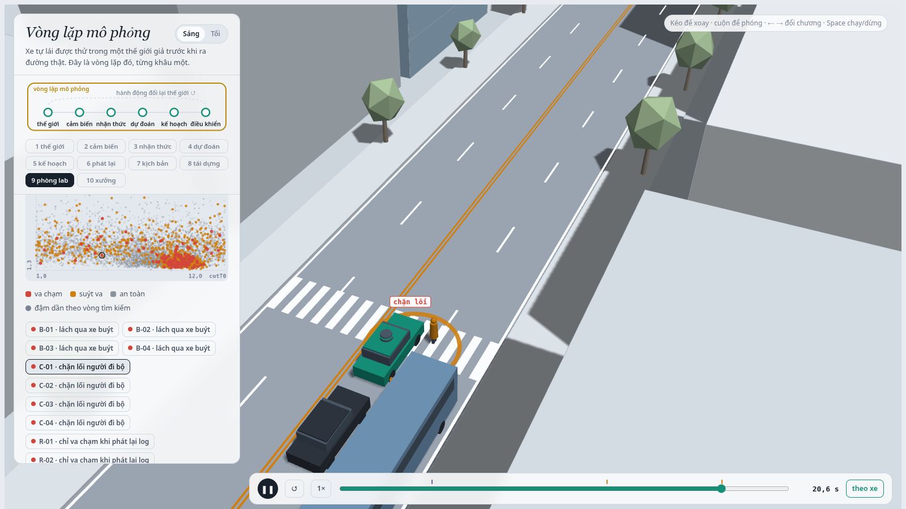
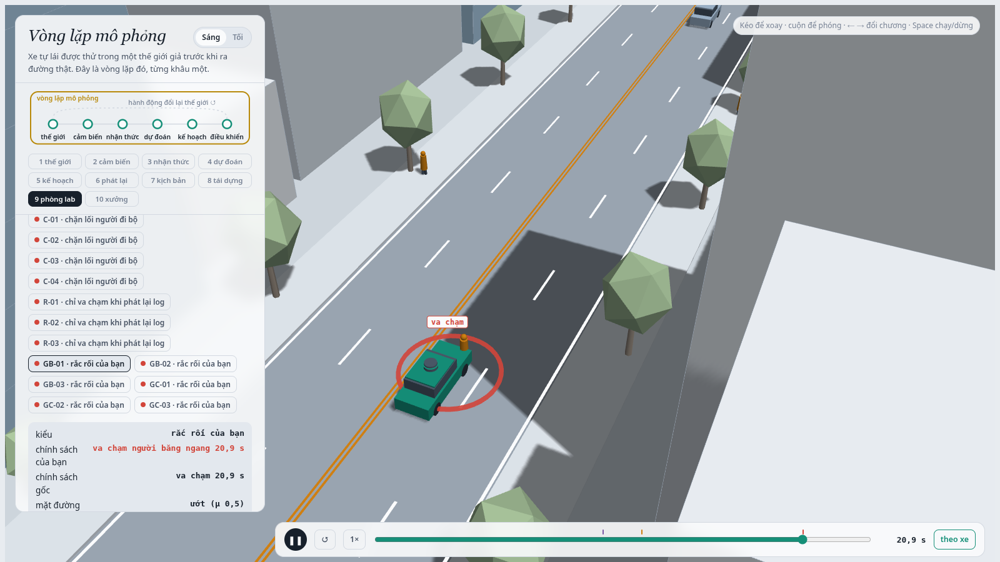

MSSV: 202602823

# Lab 11 · Scenario Forge — báo cáo

**Họ tên:** Nguyễn Mạnh Cường · **MSSV:** 2A202602823

Thị trấn của bạn (`meta.json: _run.town`): **A** (thị trấn mặc định: p_bin = wet 0,20 / pedLook 0,85 / brakes 0,15, cutGap trung vị 12 m).

> Ghi chú chạy: MSSV có chữ "A" nên dòng đầu REPORT.md không khớp regex chỉ-chữ-số của `run_all.py`; mọi bước được chạy với `LAB11_MSSV=2A202602823` (đúng cách grader truyền MSSV), `python run_all.py all` rồi `mine hazard.json` + `export`, **không** dùng `--quick` (`meta.json: steps.*.quick = false`).
> Số nào **không** nằm trong `evidence/` (chạy thêm để giải thích) được ghi rõ là *"chạy thêm, ngoài evidence/"*.

## 1. Phát lại log có trung thực không? (bước A)

| `replay.json` | giá trị |
|---|---|
| `n` / `dropped_human_crash_logs` / `n_used` | 400 / **0** / 400 |
| `replay.crashes` (planner trên log phát lại) | **106** — `rear` 96, `side` 10 |
| `reactive.crashes` (planner, thế giới phản ứng) | **0** |
| `crash_in_both` | 0 |

Không log nào bị bỏ (người lái IDM "HUMAN" không gây va chạm trong 400 kịch bản này). 96/106 va chạm khi phát lại là **`rear`**: planner lái thận trọng hơn người lái trong log (T = 1,6 s so với 1,1 s, giảm còn `cautionV` = 7,5 m/s khi gần vạch bị xe buýt che, dừng nhường P1 sớm hơn). Các xe khác (TG, C2) chạy **đúng quỹ đạo đã ghi**: log không biết xe ta hôm nay phanh sớm hơn người lái, nên xe phía sau cứ thế chạy vào chỗ xe ta đang đứng mà không phanh. Đó là va chạm **giả**: trong thế giới phản ứng, cùng 400 kịch bản cho 0 va chạm, vì TG/C2 lái IDM và phanh theo xe ta. Ngay câu chuyện mặc định cũng vậy: `world.json: replay_events = [ego|TG, t = 14,8 s, fake = true]`, còn `reactive_events = []`.

**Một kịch bản trong `replay_only`:** `replay_only[0]` (scenario 1, `contact = rear`, `min_ttc_reactive = 7,46 s`), xem trong trình xem là R-01: xe ta chậm lại trước vạch qua đường (người đi bộ P1 đang qua, xe buýt đỗ bên phải). Trong log, C2 (tím) đã nhập vào làn E1 **sau** xe của người lái, và người lái qua vạch sớm hơn. Khi phát lại, C2 cứ theo đúng đường đã ghi và đâm vào đuôi xe ta lúc 18,4 s ("va chạm giả (phát lại)"). Trong thế giới phản ứng, cùng kịch bản đó TTC nhỏ nhất vẫn còn 7,46 s.

## 2. Kịch bản bất khả thi (bước B)

Luật trong `feasible.is_feasible`:

| Luật | Căn cứ vật lý |
|---|---|
| a_lat = (π/cutDur)²·3,5/2 > μ·g → loại | Đổi làn hình cosin 3,5 m trong `cutDur` giây có gia tốc ngang đỉnh như trên; lốp không cho quá μ·g (ma sát Coulomb). Đường ướt μ = 0,5 → cutDur < ~1,9 s là không thể. |
| cutBrake > μ·g → loại | Gia tốc phanh dọc cũng bị chặn bởi ma sát lốp–đường. |
| pedV > 2,5 m/s → loại | Người đi bộ thường 1,2–1,5 m/s, rảo bước ~2 m/s; > 2,5 m/s là chạy, không còn là kiểu "đi bộ qua đường" của mô hình. |
| cutV ∉ (0, 22] m/s → loại | Xe chuyển làn phải đang chạy; 22 m/s ≈ 80 km/h là quá xa so với phố đô thị 50 km/h. |

`hunt.json: infeasible`: **bus_bypass 8**, **crosswalk_block 8**, cut_in 7, rear_ended 2 (tổng 25/9 600 mẫu săn). Cả 25 đều bị loại vì **luật gia tốc ngang** (cutDur 1,10–1,88 s, 15/25 trên đường ướt), và phần lớn rơi vào 3 vòng đầu (bus_bypass: 3, 4, 1, rồi 0).

Vì sao CEM bị kéo về đó: điểm nguy hiểm (TTC tới C2, khoảng phanh còn lại) **tăng** khi C2 cắt làn gắt hơn và đường trơn hơn. Một cú cắt làn 1,1 s trên đường ướt "nguy hiểm" hơn mọi kịch bản thật, nên nếu được chạy và chấm điểm thì nó vào elite và kéo mean của `cutDur` xuống, p(wet) lên. Vì pipeline loại chúng **trước** `cem_update` (chỉ `Z[feas]` được dùng), q không trôi về đó: trong lần chạy của tôi, số mẫu bất khả thi giảm về 0 sau vòng 3. Tỉ lệ 25/9 600 = 0,26 %, thấp hơn cả Monte Carlo tự nhiên (`mc.json: infeasible = 18`/3 000 = 0,6 %). Tôi cũng ghi nhận trung thực rằng *(chạy thêm, ngoài evidence/)* khi mô phỏng cưỡng bức 25 mẫu đó thì 0 cái va chạm (TTC trung vị 6,7 s). Nếu **đếm** chúng là va chạm, ước lượng bị thổi phồng bằng những sự kiện không thể xảy ra (xe ngoài đời không thể đổi làn như thế), và vì các mẫu này nằm ở đuôi p nên trọng số w = p/q của chúng có thể rất lớn, một mẫu như vậy đủ quyết định cả con số. Sai số đó là chệch lên, không giảm khi tăng n.

## 3. Monte Carlo cho bạn biết gì (bước C1)

`mc.json`: **k = 2**, **n = 3 000**, **p̂ = 6,67·10⁻⁴**, Wilson 95 % **[1,83·10⁻⁴; 2,43·10⁻³]**, cả hai va chạm là `bus_bypass` (`modes = {bus_bypass: 2}`), 18 kịch bản bất khả thi bị bỏ.

Để khoảng tin cậy còn ±20 % của p: 1,96·√(p(1−p)/n) = 0,2·p ⇒ n ≈ 1,96²/(0,04·p) ≈ **96/p ≈ 144 000 lần chạy** (gấp 48 lần ngân sách 3 000).

Kiểu **chưa hề xuất hiện** trong 3 000 lần: `cut_in`, `crosswalk_block`, `rear_ended` và `other` (`mc.json: per_mode.*.k = 0`). Với các kiểu này, con số đúng **không phải 0** mà là cận trên Wilson **`per_mode.*.hi` = 1,28·10⁻³** (quy tắc ba cho 3/3 000 = 1,0·10⁻³). "Chưa thấy" chỉ có nghĩa là "nhỏ hơn khoảng 10⁻³", không phải "không bao giờ".

## 4. Importance sampling, ESS và độ suy biến (bước C3)

`estimate.json`, mỗi kiểu n = 600 mẫu/seed từ hỗn hợp 0,8·CEM + 0,2·tự nhiên:

| kiểu | seed | p | hits | ess | top_share | ghi chú |
|---|---|---|---|---|---|---|
| bus_bypass | 0 | 1,01·10⁻³ | 40 | 127 | 0,28 | |
| bus_bypass | 1 | 7,25·10⁻⁴ | 40 | 110 | 0,20 | |
| bus_bypass | 2 | 1,06·10⁻³ | 36 | 126 | 0,31 | |
| cut_in | 0/1/2 | 0 → báo **≤ 0,025** | 0/0/0 | 121/122/133 | 0 | `upper_zero_hits = 0,025` |
| crosswalk_block | 0 | 1,59·10⁻⁶ | 87 | 123 | 0,42 | |
| crosswalk_block | 1 | 6,25·10⁻⁷ | 84 | 121 | 0,41 | |
| crosswalk_block | 2 | 2,63·10⁻⁷ | 78 | 120 | 0,28 | |
| rear_ended | 0/1/2 | 0 → báo **≤ 0,025** | 0/0/0 | 133/116/136 | 0 | `upper_zero_hits = 0,025` |
| **total** | 0/1/2 | 1,02·10⁻³ / 7,25·10⁻⁴ / 1,07·10⁻³ | | | | hi: 2,98 / 2,43 / 3,14·10⁻³ |

**Các seed có đồng ý không?** `bus_bypass` thì có: ba seed nằm trong khoảng ×1,5 của nhau (7,2·10⁻⁴ đến 1,06·10⁻³) và khớp Monte Carlo (6,7·10⁻⁴, Wilson [1,8·10⁻⁴; 2,4·10⁻³]). `crosswalk_block` thì **không**: ba seed chênh nhau **6 lần** (2,6·10⁻⁷ đến 1,6·10⁻⁶), dù seed nào cũng có ~80 hits. Đó chính là bẫy 3 trong README: cuộc săn tìm ra **một** cách chặn lối (đường ướt, người không ngó qua xe buýt) cực hiếm theo p, chứ không chắc là cách chặn lối hay xảy ra nhất. Monte Carlo (0/3 000, cận 1,28·10⁻³) không mâu thuẫn nhưng cũng không kiểm chứng được gì ở mức 10⁻⁶. Với `cut_in` và `rear_ended` (0 hits), tôi báo cận trên `upper_zero_hits` = 3/(0,2·600) = **0,025**, **không** báo 0, và **không** dùng 3/ESS.

**`top_share`**: trong `estimate.json` không ô nào vượt 0,5 (lớn nhất 0,42, crosswalk_block seed 0). Nhưng trong bước E thì có: `fix.json: baseline_train.bus_bypass.top_share = 0,80` (23 hits) và `baseline_test.crosswalk_block.top_share = 0,58`; các ứng viên `T=2.0` và `cautionV=6.5` có crosswalk_block top_share 0,72–0,73. Khi top_share > 0,5, một mẫu duy nhất mang hơn nửa ước lượng: p ≈ w_max/n, nên con số thực chất là "trọng số p/q của **một** điểm chia cho n". Đổi seed là con số nhảy theo điểm nặng ký kế tiếp, và khoảng ±1,96·se thì hẹp sai vì se cũng bị điểm đó chi phối. Ngược lại, top_share thấp **không** chứng minh ước lượng đúng: nếu q bỏ sót hẳn một vùng va chạm thì không mẫu nào nặng ký cả (đó có thể là lý do crosswalk_block lệch 6× giữa các seed dù top_share ≤ 0,42).

**Ngân sách:** `budget = 16 800` lần chạy cho cả 4 kiểu (mỗi kiểu 8×300 săn + 3×600 ước lượng = 4 200). Monte Carlo cần, cho cùng độ chính xác tương đối (n ≈ (1−p)/(p·(se/p)²)):

- `bus_bypass` (se/p ≈ 0,30–0,38): **6 400–15 000** lần MC. Kiểu này không hiếm lắm (~10⁻³), nên IS chỉ ngang MC.
- `crosswalk_block` (se/p ≈ 0,36–0,52, p ~ 3·10⁻⁷–1,6·10⁻⁶): **2,3·10⁶ – 3·10⁷** lần MC, tức gấp ~10³–10⁴ lần ngân sách 4 200 của kiểu đó. Đây là chỗ IS thật sự có lợi (nếu q không bỏ sót vùng nào).

**Phần `other`:** lấy từ Monte Carlo C1 (`estimate.json: other = {k: 0, n: 3000, p: 0, hi: 1,28·10⁻³, source: mc.json}`). Va chạm không thuộc kiểu nào không có điểm nguy hiểm riêng để CEM leo theo, nên không săn được. Vì k = 0, tổng cộng thêm cận 1,28·10⁻³ vào đầu trên (`seeds[*].hi`), để tập va chạm được chia đủ (các kiểu + `other`).

## 5. Các kiểu thất bại (bước C2 + 3D)

`hunt.json: found` của từng cuộc săn:

| cuộc săn | found | elite level cuối |
|---|---|---|
| bus_bypass | `{bus_bypass: 178}` | 0,0 (dừng siết từ vòng 4) |
| cut_in | `{bus_bypass: 24}` | −3,19 |
| crosswalk_block | `{crosswalk_block: 57, bus_bypass: 1}` | 0,0 (vòng 8) |
| rear_ended | `{crosswalk_block: 10, bus_bypass: 2}` | −1,20 |

**Lách qua xe buýt (bus_bypass)**, B-01, đường ướt, cutGap 5,4 m: xe buýt đỗ chặn làn ngoài E2, nên C2 (tím) phải lách sang làn E1 của xe ta với tốc độ thấp (< 6 m/s, x < 112 m), chấp nhận một khe rất ngắn. Planner chỉ coi C2 là "xe phía trước" khi C2 đã vào sâu trong ngưỡng ngang `cutinLat` = 2,15 m, quá muộn để dừng trên mặt ướt, và đâm vào sườn sau C2 lúc 12,65 s. Bóng mờ (policy đã sửa `cutinLat = 3,0`) nhận C2 làm leader sớm hơn và dừng phía sau: "chính sách gốc: không va chạm" trong bảng đọc.

**Chặn lối người đi bộ (crosswalk_block)**, C-01, đường ướt, `pedLook = 0`: người đi bộ P1 bước ra từ sau xe buýt đỗ ở vạch qua đường mà không ngó qua đầu xe buýt. Cảm biến xe ta không thấy P1 sau xe buýt nên chỉ giảm về `cautionV` = 7,5 m/s. Khi P1 hiện ra, xe ta phanh, nhưng với μ = 0,5 nó dừng khi thân xe đã nằm trên vạch, chắn lối P1 lúc 20,55 s (`kind = block`).

**Không tìm thấy:** `cut_in` và `rear_ended`. Cả hai cuộc săn không cho một va chạm nào đúng kiểu (elite level dừng ở −3,19 và −1,20, tức TTC nhỏ nhất ~3,2 s và ~1,2 s, chưa chạm). IS cho 0 hits ở cả 3 seed. Tôi tin ở mức vừa phải rằng chúng hiếm hơn bus_bypass: cận đúng chỉ là ≤ 0,025 (IS) và ≤ 1,28·10⁻³ (MC). Ngân sách này không chứng nhận được chúng nhỏ hơn 10⁻³. Một CEM đơn mode, cục bộ, cũng có thể bỏ sót một vùng hẹp (ví dụ C2 cắt làn rồi phanh ngay, `brakes = 1`).

**Nếu chỉ săn một cuộc chung:** CEM co về kiểu dễ nhất. Chính dữ liệu cho thấy: cuộc săn **cut_in** chỉ tìm ra `{bus_bypass: 24}`, cuộc săn **rear_ended** tìm ra `{crosswalk_block: 10, bus_bypass: 2}`. Điểm nguy hiểm kéo q về chỗ va chạm dễ nhất (lách xe buýt), và một cuộc săn chung sẽ cho ra 178+ ví dụ lách xe buýt mà gần như không có `crosswalk_block` (vốn hiếm ~10⁻⁶). Vì thế mỗi kiểu cần một cuộc săn với điểm nguy hiểm riêng.

## 6. Sửa planner (bước E + 3D)

Policy được chọn bằng `choose_policy` trên TRAIN: **`{"cutinLat": 3.0}`** (`fix.json: chosen.policy`).

| | fail | fail_hi | fail_hi_seen | unseen | quãng đường (m) | phanh gấp (khung/kịch bản) |
|---|---|---|---|---|---|---|
| gốc, TRAIN (`baseline_train`) | 2,72·10⁻³ | 6,99·10⁻³ | 6,99·10⁻³ | – | 214,2 | 8,39 |
| bản sửa, TRAIN (`chosen`) | 1,76·10⁻⁷ | 2,98·10⁻⁷ | 2,98·10⁻⁷ | bus_bypass | 214,3 | 7,18 |
| **bản sửa, TEST** (`chosen_test`) | **4,01·10⁻⁷** | **3,88·10⁻²** | **7,75·10⁻⁷** | bus_bypass | **213,9** | **8,00** |
| **gốc, TEST** (`baseline_test`) | **6,58·10⁻⁴** | **2,53·10⁻³** | **1,26·10⁻³** | – | **213,9** | **8,50** |

TRAIN chỉ dùng để sàng; con số báo cáo là TEST (seed mới, săn lại dưới chính policy đó, holdout tự nhiên 3 000 mẫu cho `other_crashes`: 0/3 000 cho cả hai). Trên TEST, cuộc săn mới **không tìm được một vụ `bus_bypass` nào** dưới `cutinLat = 3.0`, còn policy gốc có 22 hits (`baseline_test.bus_bypass.p = 6,58·10⁻⁴`). Quãng đường không đổi (213,9 m), phanh gấp giảm từ 8,50 xuống 8,00 khung.

**Vì sao `fail_hi` của bản sửa (3,88·10⁻²) lớn hơn cả `fail` của policy gốc (6,58·10⁻⁴) dù bản sửa tốt hơn thật?** Vì kiểu `bus_bypass` đã biến mất (`unseen`), cận hợp lệ của nó là `upper_zero_hits` = 3/(0,2·400) = **0,0375**, cộng với cận `other` 1,28·10⁻³. Với n = 400, không thể chứng nhận một kiểu đã biến mất dưới ~10⁻². `fail_hi_seen` = 7,75·10⁻⁷ là cái dữ liệu cho thấy, không phải cận cho cả policy. Muốn chứng nhận bus_bypass < 10⁻³ cần cỡ 15 000 lần chạy trên đúng vùng đó.

**Núm "nghe thì an toàn hơn" nhưng làm tăng thất bại** (TRAIN, `fix.json: table`, so với gốc crosswalk_block p = 1,76·10⁻⁷, 49 hits):

- **`T = 2.0`** (giữ khoảng cách xa hơn): crosswalk_block tăng lên **7,39·10⁻⁷ (86 hits)**, gấp ~4 lần, và quãng đường giảm còn 204,1 m. Thế giới phản ứng: người đi bộ chấp nhận khe (`pedGap`) dựa trên xe gần nhất họ **thấy**. Xe ta tụt xa sau L1 thì mở ra một khe lớn sau L1, P1 bước ra giữa L1 và xe ta, và xe ta (bị xe buýt che) tới vạch đúng lúc P1 đang qua, phải phanh gấp và dừng trên vạch. Khe lớn hơn cũng mời C2 chen vào (gap acceptance của xe chuyển làn).
- **`cautionV = 6.5`** (chạy chậm hơn gần vạch bị che): crosswalk_block tăng lên **7,34·10⁻⁷ (66 hits)**. Xe ta chậm hơn thì khe thời gian mà P1 thấy lớn hơn, người đi bộ quyết định băng sang nhiều hơn, và xe ta mất nhiều thời gian hơn trong vùng vạch nên dễ bị kẹt trên đó hơn. Ngược lại, `cautionV = 5.0` xoá gần hết thất bại nhưng mất 19 % quãng đường (173,8 m) nên bị loại. Đó cũng là cái bẫy "mọi kiểu đều unseen" của TRAIN.

Ảnh có bóng mờ: B-01 ở trên (xe ta với policy gốc đâm C2; bóng mờ = bản sửa `cutinLat = 3.0` dừng lại phía sau, "không va chạm").

## 7. Từ mô phỏng ra đường thật

| Giả định (`space.py`) | Dữ liệu thật thay nó | Nếu sai thì con số sai theo hướng nào |
|---|---|---|
| **Khe chấp nhận khi chuyển làn** `cutGap` ~ lognormal(trung vị 12 m, σ 0,5) và thời gian chuyển làn `cutDur` | Quỹ đạo xe từ drone: highD / exiD / NGSIM (gap chấp nhận lúc chuyển làn, phân phối thời gian đổi làn), tốt nhất là video trên chính phố có điểm dừng xe buýt (lách xe buýt khác nhập làn cao tốc). | bus_bypass gần như hoàn toàn do khe ngắn. Nếu người thật (đặc biệt xe máy/taxi ở VN) chấp nhận khe ngắn hơn 12 m, `bus_bypass` (~10⁻³) đang bị **ước lượng thấp**; nếu tài xế thật thận trọng hơn thì ngược lại. |
| **Người đi bộ ngó qua xe buýt** `pedLook` = 0,85 và khe chấp nhận `pedGap` (trung vị 4,5 s) | Quan sát video tại các trạm buýt có vạch qua đường (đếm người ngó/không ngó, đo khe họ chấp nhận), hoặc tập inD (giao lộ Đức) / dữ liệu camera giao thông đô thị. | Trong `cloud.json`, 66/67 va chạm `crosswalk_block` của cuộc săn có `pedLook = 0`. Nếu thực tế ít người ngó hơn 85 % (vội, trẻ em, nhìn điện thoại), `crosswalk_block` đang bị **ước lượng thấp**; nếu `pedGap` thật ngắn hơn thì cũng thấp. |
| **Đường ướt** p = 0,20 với μ = 0,5 (khô 0,8) | Số liệu khí tượng: tỉ lệ giờ có mưa/đường ướt theo mùa ở thành phố mục tiêu (Hà Nội mùa mưa > 20 %); đo μ bằng xe đo ma sát / dữ liệu ABS từ đội xe. | Trong `cloud.json`, 67/67 va chạm `crosswalk_block` và 150/205 va chạm `bus_bypass` là đường ướt μ = 0,5: đường trơn quyết định việc dừng kịp. Mùa mưa nhiều hơn 20 % hoặc μ ướt thật < 0,5 (vạch sơn, dầu) thì **tổng đang bị ước lượng thấp**; ở thành phố khô thì cao. |

## 8. Giới hạn

1. **Một con phố, một dàn diễn viên cố định:** một xe buýt đỗ trước đúng một vạch qua đường, một xe chuyển làn C2, một người đi bộ P1, một xe bám đuôi TG, kịch bản 24 s. Xác suất ở đây là "mỗi lần đi qua đúng đoạn phố này", không phải mỗi km hay mỗi giờ lái. Không có xe máy (phương tiện chính ở VN), giao lộ có đèn hay nhiều làn đường.
2. **Người lái là IDM có luật:** chấp nhận khe, nhường người đi bộ, không mất tập trung, không vi phạm luật, không phản ứng trễ. Các biến trong `space.py` độc lập với nhau (thực tế: trời mưa thì người đi bộ vội hơn, tài xế chấp nhận khe khác). Đuôi phân phối thật dày hơn, nên con số có thể thấp hơn nhiều so với thật.
3. **Cảm biến hoàn hảo trừ phần xe buýt che;** planner chỉ phanh, không đánh lái; IS chỉ tìm quanh các cách va chạm CEM đã tìm (một mode Gaussian cho mỗi kiểu), nên `cut_in`/`rear_ended` chỉ có cận ≤ 0,025.

**Một tuần nữa:** (a) chạy Monte Carlo ~150 000 lần (≈ 10 phút với batch 512) để kiểm `bus_bypass` không phụ thuộc vào q, và chạy CEM đa mode/nhiều khởi tạo cho `crosswalk_block` để xem vì sao 3 seed lệch 6×; (b) thêm nhiễu cảm biến (dò sót, trễ 100–300 ms) và xe máy, rồi đo lại cả 4 kiểu; (c) săn `cut_in` với `brakes = 1` cố định để có cận chặt hơn.

## 9. Rắc rối của bạn (bước G + chương 10)

- **Rắc rối:** một **người băng ngang giữa khối nhà** (`type: ped`, không có vạch), bước xuống từ lề nam ở x = 130–260 m (đoạn phố sau vạch qua đường x = 122) khi xe ta còn cách 8–40 m, đi/rảo bước 1,0–2,5 m/s ngang qua làn ngoài E2 rồi vào làn E1 của xe ta. Ngoài đời: người băng ẩu giữa phố để sang quán bên kia đường, sang trạm xe buýt, chuyện rất thường thấy trên phố Việt Nam.
- **Căn cứ:** đọc `core.py` thấy planner chỉ **dự đoán** người đi bộ P1 ở vạch qua đường (`pedBuffer`, `cautionV` đều gắn với P1/WALK_X). Mọi người đi bộ khác chỉ được coi là "xe phía trước" khi họ **đã ở trong** hành lang ngang `cutinLat` của xe ta. Người băng ngang nhìn thấy rõ từ xa (không bị che) nhưng planner không phản ứng cho tới khi họ bước vào làn, nên tôi đoán nó sẽ phanh muộn.
- **Giả định** (`hazard.json: space, exposure, why`): `h0_x` [130, 260] = mọi điểm giữa khối phía sau vạch mà xe ta còn tới được trong 24 s; `h0_v` [1,0; 2,5] m/s = từ người già đi chậm tới rảo bước/chạy chậm khi băng ẩu (2,5 = trần tốc độ đi bộ của `is_feasible`); `h0_trig` [8, 40] m = khe 1–4 s ở ~10 m/s, ngắn hơn khe ở vạch vì người băng ẩu chấp nhận khe ngắn. **`exposure` = 0,02/chuyến** là ước lượng thô, *không đo*: ~20 lượt băng giữa khối/giờ trên đoạn 300 m, xe ta qua đoạn đó ~25 s, nên ~0,14 lượt/chuyến; ~15 % trong số đó bước ra khi xe còn trong 40 m, ra ~0,02. Cần đếm thật bằng video cho đúng loại phố để thay.
- **Kết quả** (`mine.json`, giao thông thị trấn A, `world = town`):

| | policy gốc (`baseline`) | bản sửa `cutinLat 3.0` (`chosen`) |
|---|---|---|
| n (khả thi) | 1 496 | 1 496 |
| va chạm xe ta | 42 | 41 |
| **avoidable** (phanh hết cỡ ngay khi thấy thì tránh được) | **41** | **41** |
| unavoidable | 0 | 0 |
| unattributed | 1 | 0 |
| low_speed (< 1 m/s) | 0 | 0 |
| avoidable_foreknown | 41 | 41 |
| P(lỗi planner \| rắc rối) [Wilson 95 %] | **2,74·10⁻² [2,03·10⁻²; 3,70·10⁻²]** | **2,74·10⁻² [2,03·10⁻²; 3,70·10⁻²]** |
| × exposure 0,02 = mỗi chuyến (cận trên) | **5,48·10⁻⁴** (7,39·10⁻⁴) | 5,48·10⁻⁴ (7,39·10⁻⁴) |

`accepted = 0,997` (1 496/1 500 khả thi; 4 bị loại bởi luật đổi làn của thế giới, không phải bởi rắc rối). Cảnh đúng (`exact`): planner đâm người băng ngang `ego|H0` lúc 20,15 s.

**Ba loại:** `avoidable` = nếu cùng planner, từ khung đầu tiên rắc rối đã bắt đầu **và** cảm biến thấy nó, phanh hết cỡ (μg) thì không va chạm: đó là lỗi của planner. `unavoidable` = phanh như vậy vẫn đâm (vật lý không cho), không nói gì về planner. `unattributed` = va chạm trước khi rắc rối kịp xảy ra, tức một va chạm thường của thị trấn (ở đây 1 vụ dưới policy gốc: `ego|C2` lúc 12,7 s, đúng thời điểm và đối tượng của kiểu lách xe buýt, và biến mất với `cutinLat 3.0`). Ở rắc rối này `avoidable_foreknown` = `avoidable` = 41: người băng ngang không bị che, nên thấy ngay khi họ bước xuống (`examples[*].fire_t = brake_t`); bị che tầm nhìn không tốn gì ở đây.

**"Tránh được" là chuẩn lạc quan, theo hai hướng.** (1) Nó **đếm nhiều hơn** số vụ một planner thật tránh được: "người phanh" là một oracle biết ngay khung đầu tiên rằng người kia **sẽ** băng qua và phanh tối đa không trễ, trong khi một planner thật phải chờ đủ bằng chứng (người dưới lòng đường có thể chỉ đứng mép) và có trễ phản ứng. Vì thế 41 là **cận trên** của số lỗi "lẽ ra phải tránh". (2) Nó lại **đếm ít đi** ở chiều kia: chỉ thử phanh, không thử đánh lái hay giảm tốc nhẹ từ sớm, nên vụ nào đánh lái mới tránh được bị xếp vào `unavoidable` (ở đây 0, nên hướng này không ảnh hưởng).

**So với lách xe buýt:** người băng ngang ~**5,5·10⁻⁴ mỗi chuyến** (cận 7,4·10⁻⁴), còn lách xe buýt `estimate.json` ~7,2·10⁻⁴ – 1,06·10⁻³ (MC 6,7·10⁻⁴). Cùng bậc, khoảng một nửa đến ngang nhau, **nếu** tin exposure 0,02. Khác biệt quan trọng: bản sửa ở bước E **xoá được** lách xe buýt trên TEST nhưng **không cứu** người băng ngang (41 → 41 avoidable).

- **Bạn tự lái thì sao:** tôi không tự lái ở chế độ "Bạn" trong chương 10 (scene `hazard.json` có `ego: planner`, không có `egoAcc`). Bằng chứng thay thế là oracle trong `mine.json`: phanh hết cỡ ngay khi người kia bước xuống thì tránh được **cả 41/41** vụ. Một người lái chỉ cần nhả ga và phanh vừa khi thấy người đứng mép đường bắt đầu bước ra, việc mà planner không làm.
- **Cách sửa:** *(chạy thêm, ngoài evidence/, cùng 1 496 mẫu `mine`)* các núm hiện có **không** sửa được mà không phá planner: `cutinLat` 3,0 / 3,3 / 3,45 vẫn 41 avoidable; `pedBuffer = 6` vẫn 41 (núm này chỉ áp cho P1 ở vạch); `b = 6` 40; `s0 = 6` 32; `T = 3` 14; `v0 = 9` 9; `cautionV = 5` 4 (nhưng `cautionV = 5` mất 19 % quãng đường ở bước E). `cutinLat = 3.6` cho **0** va chạm, nhưng vì hành lang 3,6 m > bề rộng làn 3,5 m nên xe làn bên cũng bị coi là xe phía trước: trên holdout tự nhiên 3 000 mẫu, quãng đường rơi từ 213,9 xuống **135,5 m** (−37 %) và phanh gấp từ 8,5 lên **87,5 khung**. Không chấp nhận được. Planner cần **logic mới**: mở rộng phần dự đoán người đi bộ (hiện chỉ cho P1 ở vạch) cho **mọi** người đi bộ nhìn thấy được. Với mỗi người đang di chuyển về phía làn xe ta, tính thời điểm họ vào hành lang (`t_enter = khoảng cách ngang / vận tốc ngang`) và thời điểm xe ta tới vị trí x của họ (`t_arrive`). Nếu `t_enter < t_arrive + pedBuffer` thì coi họ như một vật cản dừng tại x của họ (giống cách planner đang làm với P1), hoặc ít nhất hạ `v0` xuống mức đủ dừng trong khoảng cách còn lại (v ≤ √(2·b_comfort·d)).
